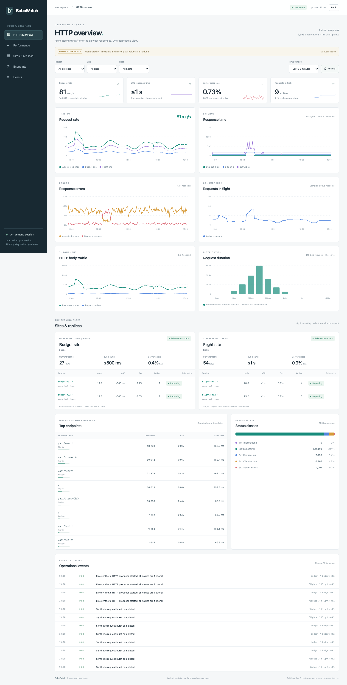

# BoboWatch

A small, standalone monitoring tool for multiple projects, sites and replicas.
One Python process, a local-network dashboard and a local SQL database.

The dashboard shows HTTP request rate and counts, latency bounds and weighted means,
slow responses, errors, active requests, body throughput and sizes, searchable
endpoints and replica comparisons. The macOS installed runtime
adds a verified five-GiB RAM disk, circular retention, live quota administration
and explicitly started crash supervision. Installed dashboards open directly on
your trusted local network without login; app ingestion and local controls retain
their credentials. One pinned Waitress dependency; no
external collector suite, frontend build or database server.

**[Installation, deployment, upgrades and Flightrepo rollout](docs/runtime.md).**
**[Dashboard controls and metric definitions](docs/dashboard.md).**
**[Production-readiness review and prioritized roadmap](docs/production-readiness.md).**

This is a tested local pilot. Host sampling, public uptime probes, ingestion
progress and alerting remain future work. Operation is on demand: installation
starts nothing; `deploy` combines stop/install/start/check; `start` loads a restartable session, `stop` unloads it, and `serve`
is a foreground alternative. No login/boot auto-start. Installed history is
RAM-only and can be lost on reboot, power loss or explicit volume release.



## Start the demo

Requires Python 3.11+ on macOS or Linux. Run from this checkout:

```sh
python3 -m venv .venv
.venv/bin/python -m pip install -r requirements-core.txt
.venv/bin/python -m bobowatch demo
```

Open [http://127.0.0.1:8720](http://127.0.0.1:8720). The dashboard asks for the
admin token in `~/.local/state/bobowatch-demo/admin.token`; read that local file
and paste its contents into the login form. Tokens stay in the browser tab's
memory, not URLs or browser storage.

The demo generates fictional requests and events for two projects. A fresh
runtime first seeds 30 minutes of fictional observations into SQL, then receives
live synthetic traffic. Existing history is never backfilled or overwritten. It contacts
only its own loopback ingestion API. Stop it with Ctrl-C. Run the same command
again to continue using the existing database and credentials; new producer runs
appear under the same replica identities.

For another port or runtime location, use a separate directory:

```sh
.venv/bin/python -m bobowatch demo --state-dir /tmp/bobowatch-demo --port 8721
```

For a fresh review with the richer HTTP history, use a new demo runtime:

```sh
.venv/bin/python -m bobowatch demo --state-dir "$HOME/.local/state/bobowatch-demo-http"
```

Existing runtime configuration is never overwritten. Edit `monitor.toml` to
change an existing runtime's port. Keep data, tokens and backups outside the
source checkout. Generated secrets have mode 0600 and new runtime directories
have mode 0700.

## What is implemented

- TOML inventory for arbitrary projects, sites, hosts and expected replicas.
- A dependency-free `Monitor` adapter with explicit request/event hooks, bounded
  in-memory state and background HTTP delivery. Request recording does no
  telemetry disk or network I/O.
- Per-replica producer credentials and a separate admin credential.
- Versioned JSON snapshots, monotonic process counters, fixed latency histograms,
  immutable run identity, sequence deduplication and atomic event acceptance.
- A bounded single SQL writer, versioned/checksummed migration, WAL storage,
  foreign keys and a lock preventing two monitoring processes on the same database.
- Dashboard project/site/host/time filters, replica drill-down, roughly 180 chart
  buckets per selected window, hover/keyboard readouts and togglable chart series.
- A sortable cross-site comparison of observed traffic, 5xx impact, weighted
  mean/p95 duration, slow-response share and telemetry reporting.
- A latency-over-time heatmap with every histogram count, responsive display
  grouping, count/share colors and exact keyboard/touch readouts. Source-level
  partial, clock-skew and extended-HTTP sample counts survive SQL grouping.
- Requests per second or per bucket, p50/p95/p99 bounds, weighted mean duration,
  responses over one second, 4xx/5xx shares and counts, in-flight work, measured
  body throughput and mean sizes, and response-class mix with coverage.
- Endpoint search, minimum request counts, pagination and rankings by traffic,
  server errors, error rate, mean latency or total response time. Contribution shares
  use all instrumented endpoints before table filters or pagination. Quiet failing
  or slow routes can appear alongside busy endpoints. One-click site/replica focus
  and an explicit scope indicator make drill-down easy to clear.
- Waiting, stale, clock-skew, partial-observation and disconnected states.
- Locally expiring live gauges, cancellable queries, exact-range view links,
  browser Back/Forward and previous/next time navigation.
- Read-only monitor health with writer/configuration/ingestion diagnostics,
  quota and retention details, plus separate liveness and readiness endpoints.
- Consistent online SQLite backups and refusal to overwrite an existing backup.

Only **Waitress** is a core third-party dependency in this milestone. The adapter
uses the standard library; importing it neither starts threads nor imports the
server. The design's second planned dependency, psutil, arrives with host sampling.
There is no frontend build step, CDN, ORM, database server or collector suite.

## Legacy disk-backed development runtime

```sh
.venv/bin/python -m bobowatch init
.venv/bin/python -m bobowatch serve --config "$HOME/.local/state/bobowatch/monitor.toml"
```

For installed operation use [the macOS installer](docs/runtime.md). The legacy
`init` command creates private runtime configuration, an admin token and SQLite schema.
An empty installation shows no sites until inventory is configured. See
[the example inventory](examples/monitor.toml) and
[the implementation notes](docs/implementation.md) for adding a producer.
The default listener is loopback. LAN access is available through the configuration below.

## Open the dashboard from a phone or another local computer

In your private runtime's `monitor.toml`, change the listener and optionally allow
an exact local DNS hostname:

```toml
[monitor]
listen = "0.0.0.0:8720"
allowed_hosts = ["bobowatch.local"] # optional; use your computer's actual hostname
```

Keep the other existing settings, then restart BoboWatch manually. Open
`http://<this-computer-LAN-IP>:8720` from a device on the same network and use the
same admin token. `127.0.0.1` on your phone points to the phone itself.

The LAN listener accepts local IPv4 clients and private/link-local IP Host headers
plus explicitly configured hostnames. Arbitrary Host headers, public source IPs
and cross-origin API requests remain blocked. Authentication is unchanged.
Use this HTTP mode on a trusted LAN; it does not encrypt token traffic. No router
port forwarding or public deployment is required.

## Explicit export for legacy development runtimes

This command also works while the server is running:

```sh
.venv/bin/python -m bobowatch backup \
  --config "$HOME/.local/state/bobowatch-demo/monitor.toml" \
  --output /path/to/new-backup.sqlite3
```

It uses SQLite's backup API, then checks integrity and foreign keys. Store the
runtime configuration and token files separately alongside your recovery plan.
Restore to a new runtime directory with its configuration/secrets and a copy of
the backup named by `database_url`; do not overwrite a running database.

## Application integration

See [integration setup](docs/integration.md) for offline token registration, live
inventory reload, ASGI instrumentation and endpoint updates. These foundations
do not deploy or enable monitoring in a hosted application.

## GitHub repository

Source: [lichen-liu/bobowatch](https://github.com/lichen-liu/bobowatch). See
[repository setup](docs/github.md) and the [CI and branch policy](.github/README.md)
for contributing and requesting checks.

## Checks

The Python suite uses standard-library `unittest`. Core requirements are enough:

```sh
.venv/bin/python -m unittest discover -s tests -v
```

Dashboard logic uses Node's built-in test runner, with no npm packages:

```sh
node --test tests/test_*.cjs
```

Node is only needed for development checks, not for running BoboWatch.
The [browser regression suite](tests/browser/README.md) adds isolated fictional
desktop and phone checks in CI; its locked dependencies are development-only.

Optional development tools:

```sh
.venv/bin/python -m pip install -r requirements-dev.txt
.venv/bin/ruff check bobowatch tests examples installation deployment
.venv/bin/ruff format --check bobowatch tests examples installation deployment
```

The tests cover protocol/authentication boundaries, atomic retries and event
conflicts, counter resets, missing data, migration checks, inventory retirement,
backup restoration and a real HTTP process-restart/online-backup exercise.

## Instrument HTTP serving explicitly

Register bounded route templates and wrap actual request work with the adapter's
explicit lifecycle hook:

```python
from bobowatch import Monitor

monitor = Monitor(
    replica="web-r01", endpoint="http://127.0.0.1:8720/v1/ingest",
    token_file="/private/runtime/web.token", routes=("/api/search",),
)
monitor.start()
with monitor.request("/api/search") as response:
    # Perform request work, then set the actual status and encoded body sizes.
    response.status = 200
    response.bytes_sent = len(encoded_response)
    response.bytes_received = len(request_body)
```

The context counts one completion and clears its in-flight gauge on exceptions.
An uncaught exception records 500. Body throughput requires both body sizes;
uninstrumented size/concurrency values remain unknown rather than zero.
`record_request` also accepts a registered `route`, `bytes_sent` and
`bytes_received` for explicit completion hooks. Unknown route names collapse into
`unmatched`; raw paths and query strings do not become new dimensions.

New adapters emit protocol v2. The core still accepts v1 producers; extended
metrics remain unavailable for those samples. Existing v1 SQL databases migrate
in place; legacy disk runtimes receive a pre-migration backup. Installed RAM-only
runtimes do not create automatic history backups. Start a new producer
run when upgrading its wire version; upgrade the core before its adapters.

## Next milestones

See [implemented runtime/storage architecture](docs/runtime-storage-design.md)
and [operator commands](docs/runtime.md). Process/host sampling,
public probes, job/freshness hooks, alert state and server-database support remain
future work. Larger history queries aggregate the full retained range in SQL,
without row, endpoint, event or execution caps. Chart grouping is adjustable,
including every source timestamp. All table rows and a complete JSON download
remain accessible. Installed storage evicts old history at its quota. Legacy disk demos
remain unbounded unless explicitly configured. Use distinct replica slots for
concurrent serving processes.

PostgreSQL support requires a tested backend and a data migration. An unsupported
database URL fails at startup rather than silently choosing SQLite.

- [Implemented architecture and protocol](docs/implementation.md)
- [Longer-term design](docs/design.md)
- [Original illustrative schema](docs/schema.sql)
- [Initial migration](bobowatch/migrations/001.sql) and [HTTP extension](bobowatch/migrations/002.sql)
- [Original proposal and dashboard study](https://github.com/lichen-liu/flightrepo/pull/25)

### Flask and other WSGI applications

`bobowatch.wsgi.InstrumentedApp(app, factory)` wraps a WSGI callable using only
Python's standard library. Construct it after fork; call `start()` before serving
(or let the first request start it), and `close()` when serving stops. The factory
returns a `Monitor` or `ConfiguredMonitor`. Startup is safe across server threads;
monitoring startup/delivery failure leaves the application serving.

The framework may set `environ["bobowatch.route"]` to its resolved route template.
Register those templates on the monitor; unknown values collapse to `unmatched`.
Never put raw URLs, query strings or business data in route labels. For Flask, an
`after_request` hook can publish `request.url_rule.rule` when a rule exists.

Streaming responses remain streamed. The wrapper tracks request count, status
classes, errors, latency, active requests and body bytes without reading extra
request data. Sizes remain unknown for unread bodies or interrupted responses.
These are application body bytes, not network/header bandwidth. Waitress or a
reverse proxy can reject a connection before WSGI dispatch; those rejections and
connection counts require separate server instrumentation. No server dependency
is added by the adapter, and no BoboWatch database is opened by the producer.
