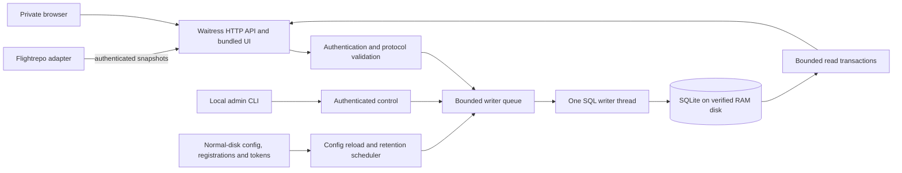

# Runtime, supervision and bounded RAM storage

Design revision: October 23, 2026. These are proposed implementation changes,
not a description of features already deployed. They supplement the broader
[design](design.md); [implementation notes](implementation.md) describe current code.

## Current implementation and revised requirements

Current BoboWatch uses one foreground Python process, Waitress, a single SQL
writer, and a disk-backed SQLite database. It has no installed runtime manager,
RAM-disk provisioning, quota enforcement, retention worker or interactive admin
shell. No infrastructure is changed by this document.

Use `fyi.boboji.watch` for the new installed runtime, following Flightrepo's
`fyi.boboji.fly` convention. On macOS:

```text
~/Library/Application Support/fyi.boboji.watch/
  venv/                       installed Python and serving dependency
  app/                        installed source/assets snapshot
  installation.json           installation receipt
  monitor.toml                private central configuration and storage policy
  registrations/              private provisioning records (new interface)
  tokens/                     admin and per-replica secrets
  jobs/                       explicitly loaded launchd definitions, if selected
  logs/                       bounded operational logs
  ramdisk.json                verified device/mount metadata; contains no history
```

The monitoring database, WAL, SHM and any SQLite spill files go on a separate,
owner-only, verified RAM volume. Never silently fall back to a normal directory
if the volume is absent. Installation, configuration and credentials remain on
normal disk. Existing prototype runtimes under `~/.local/state` are left intact;
changing runtime defaults must not delete or silently import their history.

The user explicitly chose RAM-disk-only history: no scheduled durable snapshots
and no automatic recovery from a normal-disk database after reboot. An explicit
operator-requested export may exist, but is not part of ordinary operation.
RAM-backed storage is not a guarantee that the OS never swaps memory.

## Recommended on-demand supervision

Flightrepo's current controller explicitly bootstraps launchd jobs with
`KeepAlive = true` and restart throttling. Definitions live in its private runtime,
not in the login/boot auto-load locations. `stop` unloads the jobs. Crashes are
restarted while loaded; reboot/logout ends the session and requires a manual start.

Recommend the same session behavior for BoboWatch, with a foreground alternative:

```sh
python3 installation/install.py    # install only; no process starts
./deployment/bobowatch start      # explicitly bootstrap the supervised session
./deployment/bobowatch status
./deployment/bobowatch stop       # unload; it must not restart afterward
./deployment/bobowatch serve      # foreground alternative; Ctrl-C stops it
```

These commands are proposed, not currently available. Never install the job into
`~/Library/LaunchAgents` or use boot/login auto-start. Use a single-instance lock
for both execution modes, a restart throttle, and no server-process fork per HTTP
worker. A foreground session has no supervisor restart.

The controller creates the RAM disk when first needed and verifies ownership,
device identity, volume capacity and free space. A restarted server reuses the
existing verified mount and DB; it must never reformat it. A normal stop leaves
the RAM volume mounted so another session can reuse history. An explicit release
command, logout/reboot that removes the volume, or power loss can erase it.
Preservation lasts only while that RAM volume actually survives. A missing volume
starts a new empty history epoch, visibly marked in the dashboard. New telemetry
must not turn cumulative process counters into fabricated observations before
that epoch; establish a baseline when starting a fresh history database.

Flightrepo deployment registers producers but never starts BoboWatch.

## Five-GiB storage policy

Default quota: `5 * 1024**3 = 5,368,709,120` bytes. It is a total budget for the
monitoring storage family, not five GiB for the main file plus unlimited WAL.
The dedicated RAM volume is sized to the five-GiB allocation; actual filesystem
capacity is slightly lower. Validate reported capacity/free bytes after formatting
and derive effective admission limits after filesystem overhead and a reserve.
The volume bounds stored data; SQLite caches, Python objects, queues and the
server require additional, separately bounded memory.

Initial watermarks against the nominal budget:

- Start maintenance by approximately four GiB (80%), or earlier if the real
  volume's free-space reserve requires it.
- Prune toward approximately 3.5 GiB (70%).
- Reserve the remaining capacity for WAL, checkpoints, bounded transactions,
  filesystem overhead and maintenance. Reduce these thresholds if necessary;
  never allocate five GiB of history alone.

Measure main DB, WAL and SHM file sizes, free pages, live pages, spill files,
filesystem free bytes and observed growth. Set a main-file page ceiling below
the family quota. `PRAGMA max_page_count` only limits the main database file;
it is not enforcement for the complete family. Likewise, `journal_size_limit`
is not a hard cap on an actively growing WAL.

Long readers can prevent WAL checkpoint completion. Keep existing query deadlines,
provide reader gaps for checkpoints, and reject new ingestion with retryable 503
if reserve cannot be protected. Dashboard/control access should remain usable.
Never disable transaction consistency or silently discard a new snapshot while
acknowledging it as stored. Bound transaction sizes, queue length and caches.

### Circular history

Implement a bounded SQL history buffer rather than a byte-level overwrite file:

1. Run capacity checks at ingestion boundaries and periodic maintenance ticks.
2. Delete the oldest accepted observations in small writer-owned transactions,
   including their histogram, HTTP and route rows and expired events.
3. Preserve configured identities, credentials/policy, the current producer
   high-water marks and cumulative baselines needed for correct next deltas.
4. Bound and retire obsolete run/deduplication state too; do not accumulate an
   unbounded protected record per historical run. Specify a bounded retry/event
   horizon and continue rejecting superseded runs after their history is evicted.
5. Reuse freed pages. Use incremental reclamation and checkpoints when physical
   file reduction is needed. Avoid full VACUUM at the capacity boundary.
6. Display the oldest retained timestamp and eviction counts. Old records being
   gone must not appear as zero traffic or a producer counter reset.

Use server receipt order for capacity eviction; skewed producer clocks must not
keep records indefinitely. Add the required deletion/indexing migration and
configure incremental auto-vacuum before creating new DBs. Existing DB conversion
needs explicit migration rather than editing already applied SQL migrations.

## Local admin console

Match Flightrepo's `storage status` and `storage quota` vocabulary. Proposed usage:

```sh
./deployment/bobowatch admin
./deployment/bobowatch admin storage status
./deployment/bobowatch admin storage quota 5GiB
```

```text
watch> storage status
watch> storage quota
watch> storage quota 3GiB
watch> registrations list
watch> config reload
watch> quit
```

The shell is a separate short-lived local client, not another daemon or an
independent writer to the live database. Commands go through authenticated local
control and the single server writer while running. When stopped, the CLI can
validate/edit persistent policy and inventory; live DB status is unavailable if
the RAM volume is absent. It must never create a database just to display status.

Persist quota settings outside the volatile database so they survive reboot;
the SQL copy is runtime state, not the only policy source. Report requested and
applied settings if an asynchronous update is pending. Decreasing quota schedules
bounded eviction and reports its effect. Never claim the lower physical ceiling
is applied while allocated files exceed it. Raising a quota within the verified
volume can be live; raising beyond it requires a stopped, explicit RAM-volume
resize/replacement with a fresh memory/capacity check. No unlimited RAM mode.

Status includes quota, main/WAL/SHM bytes, RAM-volume size/free bytes, reserved
space, oldest/newest history, eviction count, checkpoint pressure and mount/epoch
identity. Bound normal-disk diagnostic logs independently of the history quota.

## Capacity experiment

This Mac reports 48 GiB physical RAM. A separate seven-GiB ingestion RAM disk
already exists, so adding five GiB would bring nominal RAM-disk capacity to twelve
GiB (25% of physical RAM), before all other app/cache memory. This is plausible
for a pilot, not an unconditional memory reservation approval. Validate memory
pressure at startup and show a useful error if allocation is unsafe.

Two isolated current-schema databases were populated through the real SQL
writer, each with 8,000 synthetic v2 snapshots and four replicas. The database,
indexes and checkpointed WAL/SHM family measured approximately:

| Registered routes per replica | Bytes per snapshot | Four replicas, 15-second sampling | Ten replicas, 15-second sampling |
| --- | ---: | ---: | ---: |
| 4 | 3,203 | 51 days | 20 days |
| 20 | 5,837 | 28 days | 11 days |

Retention projections use a 3.5-GiB history allowance, not the entire five GiB.
They are extrapolations from synthetic data, not guaranteed retention periods;
large event messages, future metrics, database fragmentation and live WAL pressure
change them. Both test databases passed integrity and foreign-key checks. No
five-GiB RAM volume or circular-retention implementation was tested or installed.
See [measured results](research/ramdisk-capacity-2026-10-23.json).

## Server architecture



One server process, currently four Waitress request threads, one bounded writer
queue (currently 128 tasks) and one SQL writer thread. Dashboard reads use
independent short transactions with a two-second deadline. Add only lightweight
reload/retention scheduling and local control; no broker, ORM, separate collector,
Grafana or external SQL server. Supervision and CLI are lifecycle/control layers,
not additional always-on monitoring services. SQL backend-specific quota and
reclamation logic stays inside the SQLite backend.

Before claiming readiness, test small quotas repeatedly through fill/evict/reuse,
then a real five-GiB-volume boundary. Cover WAL growth with a blocked reader,
ENOSPC rollback, reduced quota, bounded event/run state, crash recovery, missing
mounts, stop/unload behavior and lost-volume reinitialization. RAM-disk-only
history is an intentional tradeoff, not durable archival monitoring.

References: [SQLite WAL](https://sqlite.org/wal.html),
[page limits](https://sqlite.org/pragma.html#pragma_max_page_count),
[incremental vacuum](https://sqlite.org/pragma.html#pragma_incremental_vacuum).
