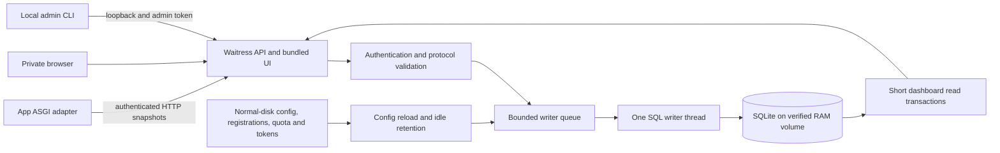

# Runtime, supervision and bounded RAM storage

Implemented October 23, 2026. See [operator commands](runtime.md) for installation,
rollout, upgrades and administration. No user runtime is deployed by this change.

## Process architecture

One process, four Waitress request threads, one SQL writer thread and a 128-task
writer queue. Reads use independent connections with a two-second query deadline.
Waitress is the only third-party core dependency. There is no broker, ORM,
collector suite or external SQL server. Backend-specific quotas/reclamation stay
inside SQLiteStore and retention.py; a future SQL backend still needs a driver,
implementation and tested migration.

Installed files live under `~/Library/Application Support/fyi.boboji.watch`,
matching Flightrepo's `fyi.boboji.fly` convention. Configuration, registration,
policy, tokens, source receipt and bounded logs use normal disk. Telemetry uses
only an owner-private RAM volume with a root-derived name. The controller proves
RAM image identity, owner, exact block count, mount, capacity and session marker
before use. Missing or replaced mounts reject storage operations; there is no
normal-disk fallback. Existing verified volumes are reused, never reformatted on
restart. A device identity mismatch is an error, never permission to erase it.

Explicit `start` bootstraps a runtime-local launchd definition with KeepAlive and
restart throttling. `stop` unloads it. Definitions are never installed into
LaunchAgents or boot/login locations. Foreground `serve` uses the same ownership
lock but no restart supervisor. Installation starts nothing. Flightrepo deploy
registers its producer without starting the monitor. Normal stop retains RAM
history; release/reboot/power loss can erase it. No automatic history backup is
created. RAM may still be swapped by the operating system.

## Storage policy and circular history

Default nominal capacity and requested quota are both **5,368,709,120 bytes**.
The dedicated volume is the physical capacity boundary; the quota measures main
DB, WAL and SHM together. SQLite temporary work stays in memory, with an eight-MiB
connection cache. Python objects and the HTTP server need memory beyond the volume.
New allocation checks physical-memory headroom and current memory pressure.

Live-page retention begins at 60% of requested quota. Physical usage at 70%
triggers checkpoints; admission reserves space and the main-file page ceiling is
80%. This deliberately leaves room for WAL, filesystem overhead, checkpoints and
bounded transactions rather than filling five GiB with history alone.

The single writer periodically checks and reclaims space in bounded batches.
Oldest server-received observations are deleted with their dependent HTTP,
histogram, route and status rows; oldest events are evicted too. Freed pages are
reused and incrementally reclaimed. Full VACUUM is never run at the boundary.
Each replica keeps only its latest run's latest baseline protected from eviction;
obsolete empty runs are removed. Retained events and the most recent 256 receipts
per replica prevent event duplication within that bounded horizon. Superseded
runs remain rejected through the latest-run state. Retry acknowledgements are
returned only after commit.

A long reader may prevent checkpoints. Capacity admission then rejects new
observations with HTTP 503 rather than acknowledge unstored data. Query deadlines
and short transactions allow later checkpoint progress. Main-file max_page_count
is not a complete WAL quota; it is one guard alongside measured family bytes,
transaction reserves and the physical volume boundary. Extremely small quotas
may be below the protected inventory/baseline minimum and stop new ingestion.

Quota policy is persistent outside RAM and reloaded live. A requested decrease
can be pending while physical files shrink; status reports `quota_applied=false`
until the family fits. Raising quota within allocated capacity is live. Replacing
capacity requires a stopped, explicit release and new allocation, losing history.
There is no unlimited RAM mode.

The database stores an epoch UUID and eviction totals. The dashboard shows epoch,
usage, oldest retained observation and evicted snapshot count. A new database
establishes a zero-delta first snapshot for each producer run, preventing old
cumulative counters from fabricating pre-epoch observations. Surviving history
continues normal deltas after server restarts.

## Validation

The unit/server suite includes small-quota repeated fill/evict/reuse, a held
reader blocking checkpoints, a live reduced quota, baseline preservation,
bounded event receipts, migration from v1, integrity/foreign-key checks,
authorization and installer/lifecycle failure paths.

A separate actual macOS five-GiB-volume probe installed an isolated foreground
runtime, registered a synthetic producer, changed quota live, restarted and
reinstalled while preserving epoch, filled SQLite to its main-file page ceiling,
verified retryable admission rejection and rolled-back-full-transaction integrity,
then released the volume and verified a fresh epoch. All test resources were
removed. It did not load a user launchd job or touch Flightrepo's live ingestion.

[Measured runtime results](research/ramdisk-runtime-validation-2026-10-23.json):
exact five-GiB volume; 4,295,032,832-byte family at the boundary; 1,052,524,544 bytes
free; integrity and foreign keys valid. Synthetic ballast exercised the physical
page ceiling/rollback; the small-quota tests exercised telemetry eviction and reuse.
This is not a claim of a multi-day production soak test.

Earlier [synthetic row sizing](research/ramdisk-capacity-2026-10-23.json) measured
roughly 3.2–5.8 KiB per v2 snapshot for four to twenty routes. A conservative
three-GiB live-history target projects roughly 24–44 days for four replicas
sampled every 15 seconds, or 10–17 days for ten. Events, fragmentation, future
metrics and WAL pressure change retention; these are estimates, not promises.

On this 48-GiB Mac, Flight ingestion and BoboWatch nominal RAM capacities total
ten GiB. Startup rejects unsafe headroom rather than silently shrinking the
requested volume. Host metrics, public probes, ingestion/freshness hooks and
alerts remain future work; the current runtime is a local HTTP-monitoring pilot.
